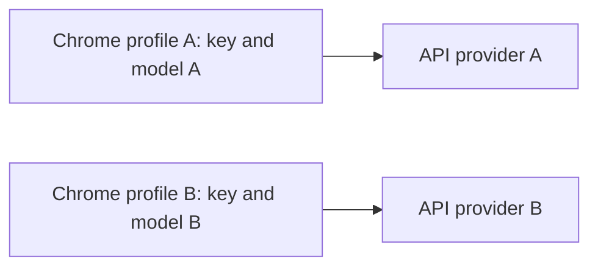
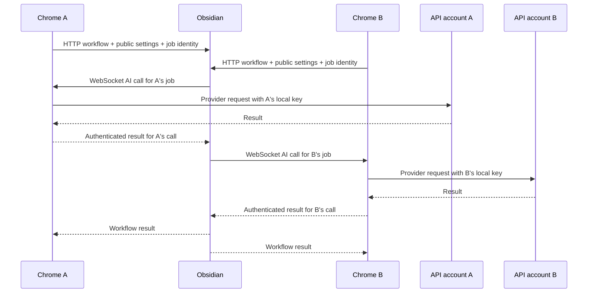
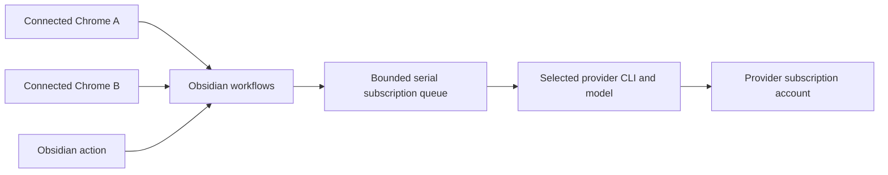

# AI execution architecture and multi-profile setup

This guide describes execution protocol 3. Connected Chrome profiles share an
Obsidian-owned execution mode, while each profile keeps its own API configuration.
Changing mode never transfers an API key between profiles or into Obsidian. An explicit connected Chrome **Save & continue** updates the native Obsidian account, as described below.

For provider installation and authorization, see [subscription setup](ai-subscriptions.md).
For readiness colors and credit display, see [connection status](connection-status.md).

## Configuration and calls

| Action | Settings and credentials | Where AI runs |
| --- | --- | --- |
| Chrome-only | Initiating Chrome profile | That Chrome |
| Connected Chrome, API mode | Initiating Chrome profile | That Chrome; Obsidian coordinates the workflow |
| Obsidian action, API mode | Separate native configuration | Obsidian |
| CLI subscription | Shared Obsidian CLI configuration | Obsidian CLI |
| ChatGPT sign-in | Shared account/model; protected local OAuth credentials | Obsidian, using the public Responses API |

Connected profiles share the selected authentication method and the CLI or ChatGPT model selection. Different API providers, models and keys are expected. Chrome-only profiles remain independent. Normal workflow requests never transmit API keys. In connected API mode, an explicit **Save & continue** also updates the native Obsidian account using the saved Chrome key/provider/model. This dedicated authenticated operation writes only to SecretStorage and replaces an existing native key on every explicit save; advanced saves and Chrome-only saves do not perform it. Native Obsidian API keys use SecretStorage; on apps without it, configure Chrome API execution or upgrade to Obsidian 1.11.4+. A legacy mirrored API configuration is an inactive migration candidate requiring explicit selection, not an automatically owned native key. On older Obsidian versions, migration renames the original settings file to an inactive `legacy-ai-settings.json`, retaining the existing key until an upgrade permits explicit secure import. It does not write a new plaintext native key.

Chrome settings retain API preferences while showing the shared connection. Chrome chooses API-key or subscription execution. In subscription mode, Obsidian offers ChatGPT sign-in, Codex CLI, Google Gemini, and Claude. Selecting a CLI connection selects its provider in one execution transition. In API mode, Obsidian's connection box is read-only, with no connection selector or API-key editor. Disabling CLI availability returns to API only when CLI execution was selected. ChatGPT credentials remain in the local plugin runtime. Native actions and connected Chrome workflows use the same ChatGPT executor; standalone Chrome has no ChatGPT route. See [sign-in and CLI setup](ai-subscriptions.md).

In API mode, Obsidian's main settings show live connected Chrome profiles, including
each profile's provider and model. These values refresh as Chrome settings change;
no native Obsidian configuration is substituted when no Chrome is connected.
API keys are edited only in Chrome. Opening Obsidian settings does not replace an existing selection.

## Three call flows

### Chrome-only



Each profile analyzes independently. Neither profile participates in Obsidian's
shared mode, and vault workflows are unavailable until it connects.

### Connected API mode



Obsidian coordinates routing, analysis, and vault work. Each delegated AI call runs
in its originating Chrome using that job's captured configuration. Obsidian-native
actions instead use Obsidian's separate API configuration. Differences between
profiles are expected, including different providers and models.

### Shared subscription mode



The CLI runs inside the plugin-owned service. No separate bridge server is needed.
All connected profiles follow the same subscription provider/model; their API keys
remain saved locally for a later return to API mode.

## Setup and mode switching

1. Configure an API provider in each Chrome profile that needs API execution.
2. Connect each profile to the same running Obsidian plugin. An unknown development
   extension may require approval in Obsidian; connection credentials are handled
   automatically.
3. Select **ChatGPT sign-in** in Obsidian or connected Chrome to use direct OpenAI OAuth. Complete authorization and allow plan usage; choose the account model in either client.
4. For CLI execution, select **Codex CLI**, **Google Gemini**, or **Claude** directly in Obsidian, then authorize and choose a model. The selection enables CLI availability automatically.
5. Mode changes apply to every connected profile. API preferences and CLI selections remain saved separately. Selecting API restores each profile's configuration.
6. **Disable subscription mode** disables CLI availability. It switches to API only if CLI was selected and leaves a selected ChatGPT connection intact.
7. ChatGPT sign-out cancels ChatGPT work but keeps the method selected. Reconnect explicitly; there is no automatic API-key fallback.

## Protocol and trust

Execution protocol 3 keeps HTTP analysis, follow-up, confirmation and streaming routes. An authenticated WebSocket carries state, delegated AI calls, results and cancellation. Chrome 116+ is required; messages every 20 seconds maintain its worker, and sessions expire after 60 seconds without activity. See [Chrome's WebSocket guidance](https://developer.chrome.com/docs/extensions/how-to/web-platform/websockets).

Credentials are exchanged by the existing trusted-extension connection flow. They bind to a persistent Obsidian instance and an individual Chrome profile. Host and Origin validation precede dispatch. The socket authenticates in its first frame, never in its URL. An unknown development extension needs approval. Connection credentials authorize local vault access, not retrieval of provider keys. Ordinary websites cannot authorize themselves with an identity header. Local software that can forge headers remains outside this browser-origin boundary.

Mode writes require expected revision and operation ID. Repeated identical operations do not repeat a transition; stale conflicting writes return authoritative state. Reads, credit refreshes and reconnects never write AI settings. Legacy configuration writes are rejected with an update-required response. Reconnect fetches state and never replays a saved offline change or interrupted inference.

### Transport responsibilities

| Surface | Responsibility |
| --- | --- |
| `/health` | Advertise instance identity, protocol version, and capabilities. |
| `GET /execution/state` | Read authoritative shared state and connected client metadata. |
| `POST /execution/mode` | Authenticated shared-mode mutation bound to the client session and instance, with `expectedRevision` and `operationId`. |
| `/execution/socket` | First-frame authentication, state notifications, delegated calls/results, cancellation, and heartbeats. |
| Existing HTTP workflow routes | Analysis, questions, confirmation/save, egg creation, and existing streaming responses. |
| `POST /execution/native-api/sync` | Explicit connected Save & continue; validates the authenticated session, instance, and API-mode revision, then updates the native account in SecretStorage. The response contains no key. |
| `POST /chatgpt/{status,signin,cancel,signout,models,model}` | Authenticated connection controls; no token or arbitrary-URL forwarding. |
| Legacy `/ai-config` and `/ai-config-status` writes | Reject with HTTP 426 and an update-required error. |

The shared snapshot contains `instanceId`, `protocolVersion`, `revision`,
`subscriptionAvailable`, `mode`, subscription provider/model, public ChatGPT connection status/revision/account label/model, and transition state.
Client metadata identifies the profile/session and its non-secret provider/model
and configuration revision. Neither contains provider keys or API endpoints.

Job admission binds the session, instance, shared revision, and local configuration
revision. Public processing settings pass an explicit allowlist. Delegated calls
carry prompt/token parameters, never credentials or a replacement destination.
Chrome accepts them only for jobs it registered locally.

## Jobs and cancellation

Every explicit action captures an immutable configuration and execution identity. Its routing calls and automatic post-save merge inherit the initiating executor. Delegated API calls are accepted only for locally registered API jobs, and results/cancellation are bound to their authenticated owner. Another profile cannot execute or answer them. Results show provider, model and connection method; follow-ups capture current settings separately.

A shared transition persists its intent before canceling old jobs, fences late results immediately, then finishes CLI cleanup before announcing ready. Restart recovers an unfinished transition. Saving an API configuration cancels only that profile's work; saving native settings cancels native work. Shared subscription changes cancel subscription work. Provider fetches and CLI jobs receive abort signals. Subscription queue waits, login and discovery are canceled on exit; provider login credentials are retained.

Automatic merges are registered children of the save job. Disconnecting the originating Chrome or changing mode defers unfinished AI work, leaving knowledge in Unprocessed. Explicit later Obsidian merges use native settings. No reconnect silently retries or borrows another key. Admission and call IDs are deduplicated during a running server session; interrupted work requires explicit retry. Exactly-once provider billing across crashes is not guaranteed.

Server-wide egg locks serialize merge contexts, knowledge appends and egg creation. Merge re-reads under the lock and retains conflict checks. Cancellation is checked before AI result writes; a protected save that has already begun may finish. Completed saves survive cancellation. Consumed quota cannot be undone.

| Event | Scope of canceled work |
| --- | --- |
| Shared API/Subscription mode change | All old-mode jobs, including native Obsidian jobs. |
| Chrome API settings saved | Jobs using that profile's previous configuration revision. |
| Native Obsidian API settings saved | Native Obsidian jobs. |
| Shared subscription provider/model changed | Subscription jobs. |
| One Chrome disconnects | That session's jobs and unfinished child merges. |
| Plugin unload | All owned jobs and subscription processes. |

Terminal cancellation fences late results before executors receive the abort.
Mode transitions close old-mode admission and finish owned CLI cleanup before
reporting ready. A disconnected profile cannot block that transition indefinitely.

## Offline recovery and status

Connected execution stops when Obsidian is unavailable, including API mode's vault workflows. Choose **Use Chrome mode instead** to explicitly use this profile's saved API setup. This is a local connection choice, clears connection-scoped errors and queues no shared mode mutation. Reconnecting follows authoritative shared state.

Connection, configuration, account readiness, quota and activity are separate. Unknown usage is not zero. Subscription credit displays Subscription and only provider-reported usage. Save and refresh are non-generating; explicit tests consume quota. Model discovery retains selections on failure, and rejected models never trigger automatic substitution. See [the signal matrix](connection-status.md) and [subscription setup](ai-subscriptions.md).

Chrome storage is restricted to trusted extension contexts and privileged messages require an extension-page sender. [Chrome storage access controls](https://developer.chrome.com/docs/extensions/reference/api/storage) and [Obsidian SecretStorage](https://docs.obsidian.md/plugins/guides/secret-storage) describe the underlying APIs.

## Migration and troubleshooting

Update both applications before using connected execution. Chrome-only API mode
remains available independently of the new connected protocol.

Migration retains Chrome API backups and per-provider preferences. Legacy standalone
subscription provider IDs are migrated to their canonical provider/connection
method, preserving custom model selections. A formerly Chrome-mirrored Obsidian API
key is an inactive candidate: explicitly select it as a native key after secure
storage is available. Do not infer native ownership from the last profile that synced.

| Symptom | Expected behavior / recovery |
| --- | --- |
| Obsidian says subscription but connected Chrome says API | Verify both applications are running the new build, reload the plugin and extension, and reconnect. An older plugin lacks the authoritative shared-state protocol; Chrome reports an update/connection error. Chrome-only profiles remain independent. |
| A and B show different API models | Expected in API mode; their configurations are independent. |
| Two profiles change shared mode at once | A stale revision is rejected with current state. Review that state before making a new explicit change. |
| Obsidian closes while subscription is selected | Analysis pauses with a red light. Reopen Obsidian or explicitly choose Chrome-only API execution. |
| Subscription authorization error remains after local recovery | Chrome-only selection clears connection-scoped errors and restores the profile's API setup. |
| A profile reconnects | It fetches authoritative mode; it does not replay changes or restart interrupted analysis. |
| Automatic merge loses its originating Chrome | Saved knowledge stays in Unprocessed. Retry explicitly; an Obsidian-native merge uses its native executor. |
| Model discovery fails | Keep the selection; refresh later or choose Auto/custom. A rejected model requires an explicit new choice. |
| Remaining subscription usage is unavailable | Display Subscription without a fabricated credit or quota balance. |

## Developer reference

| Module | Responsibility |
| --- | --- |
| `shared/src/execution.ts` | Protocol types, public-settings allowlist, state reducer, effective-mode selector, API preference migration. |
| `chrome-extension/src/background/execution-session.js` | Profile session, captured local executors, delegated calls, reconnect, and cancellation. |
| `obsidian-plugin/src/execution-coordinator.ts` | Revisioned shared state, job admission, executor ownership, cancellation, and egg locks. |
| `obsidian-plugin/src/server.ts` | Authenticated HTTP/WebSocket integration and workflow contexts. |
| `obsidian-plugin/src/subscription-service.ts` | CLI detection, authorization, models, serialized inference, and process cleanup. |

When extending a workflow, pass its execution context to every AI child operation.
Register background work before returning ownership to the caller. Check cancellation
before writes and use the shared egg lock. Keep keys/endpoints inside executors,
scope asynchronous UI responses to configuration/job identity, and keep reads free
of configuration mutations.

## Validation

Automated tests run two isolated real extension-worker contexts against one HTTP/WebSocket server and a controlled provider. They verify separate keys/models, shared switching, read-only refreshes, CAS conflicts, cross-client rejection, cancellation, lock isolation and migration. CLI tests use controlled fixtures.

Release checks still require two actual Chrome profiles on macOS, Windows and Linux and real provider accounts: installation detection, authorization/terminal handoff, model selection, Save, one explicit analysis, disconnect, restart, conflicting changes, and API → Subscription → API. Automated fixtures do not establish real account or cross-platform readiness.

From the repository root, rebuild the applications with:

```bash
npm run build:extension
npm run build:plugin
```

For protocol changes, rebuild the plugin test bundles and run the targeted tests:

```bash
cd obsidian-plugin
node esbuild.test.mjs
node --test tests-dist/execution-coordinator.test.js
node --test tests-dist/execution-wire.test.js
```

Also run the targeted Chrome connection/settings tests when changing routing or UI.
The wire test exercises two independent extension worker contexts against one server;
it does not replace real account and platform smoke tests.

### Why the lockfile lists multiple esbuild platforms

Both applications already use esbuild as a development bundler. Its native binaries
are optional OS/CPU-specific dependencies, such as `@esbuild/darwin-arm64` and
`@esbuild/android-arm`. The lockfile records their resolution for reproducible
cross-platform installs; npm normally installs only the matching platform package.
See [esbuild's platform guidance](https://esbuild.github.io/getting-started/#simultaneous-platforms).

Adding the plugin's `ws` dependency refreshed an older workspace lockfile: its root
workspace list omitted `shared` and `website`, and esbuild was nested under the plugin
with only one platform package recorded. npm hoisted the existing esbuild `0.20.2`
to the root and recorded all 23 optional platform packages. This did not upgrade
esbuild or add those binaries to the shipped application bundles. Keep the generated
entries so other development and CI platforms can resolve the appropriate binary.

## ChatGPT sign-in lifecycle

The plugin owns a separate ChatGPT service, independent of CLI discovery. It shares rotating refresh operations, caches account models for five minutes, and validates complete SSE responses before passing generated text into the existing AI processor. Account, model, and authorization-revision changes cancel obsolete ChatGPT jobs and fence their later writes. Merely refreshing status does not cancel work or start inference.

The paired Chrome connection is required for all controls and workflows. Execution handshakes require protocol 3. Update both clients together; incompatible clients receive an update error. Signed-out or revoked authorization stays selected and fails explicitly rather than falling back to API billing.
